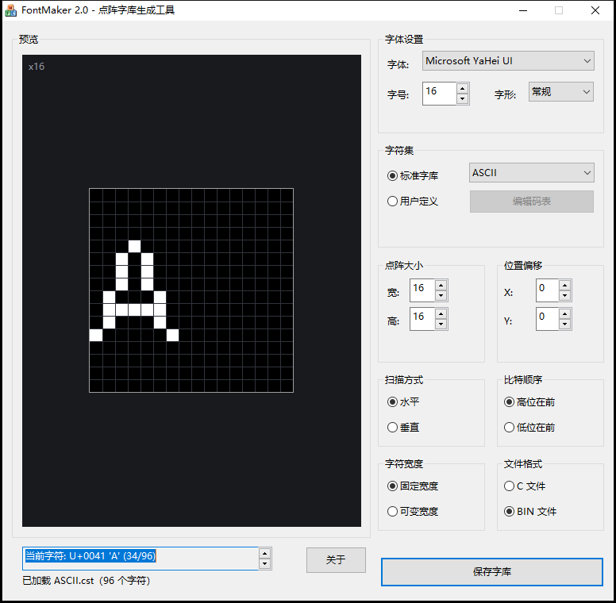
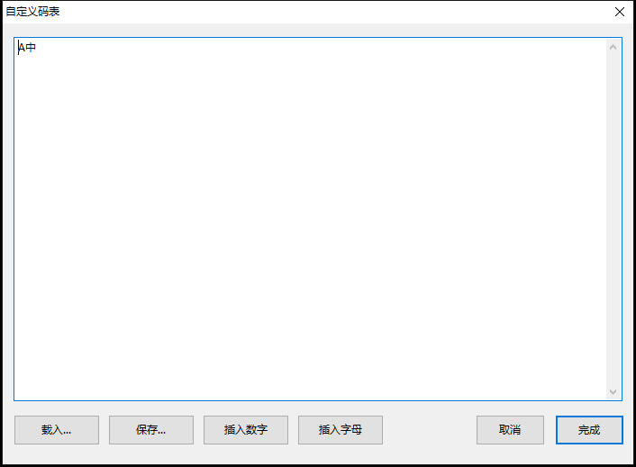

# FontMaker 2.0

FontMaker 是一个 Windows 点阵字库生成工具。它把系统字体渲染成固定大小的点阵，并按字符集顺序导出为 **C 数组**或 **BIN 字库**，用于嵌入式 GUI、单片机和自制操作系统等项目。



## 特性

- 枚举系统字体，支持字号、加粗、倾斜、点阵宽高和像素偏移
- 标准字符集（`.cst`）和自定义码表两种模式
- 横向/纵向扫描、MSB/LSB、固定/可变宽度
- 导出可编译的 C 数组或紧凑 BIN
- 原生 Win32 + GDI，不再依赖 MFC
- 核心库与 UI 分离，带纯逻辑单元测试
- 提供命令行工具，便于脚本化生成
- 自动把 `charset/*.cst` 复制到可执行文件旁

## 构建

### 环境

- Windows 10 或更高版本
- CMake 3.20+
- Visual Studio 2019/2022，安装“使用 C++ 的桌面开发”和 Windows SDK
- 或 MinGW-w64（`g++` + `mingw32-make`）

### Visual Studio

```powershell
cmake -S . -B build -G "Visual Studio 16 2019" -A x64
cmake --build build --config Release --parallel 8
ctest --test-dir build -C Release --output-on-failure
```

Visual Studio 2022 使用 `"Visual Studio 17 2022"`。也可以直接打开 CMake 文件夹，或使用预设：

```powershell
cmake --preset vs2019-x64
cmake --build --preset vs2019-x64-release
ctest --preset vs2019-x64-release
```

### MinGW-w64

```powershell
cmake -S . -B build -G "MinGW Makefiles" -DCMAKE_BUILD_TYPE=Release
cmake --build build --parallel 8
ctest --test-dir build --output-on-failure
```

### 产物

- `FontMaker.exe`：Win32 GUI
- `fontmaker_cli.exe`：命令行工具
- `charset/`：标准字符集（构建后自动复制到 EXE 旁）

发布包：

```powershell
cmake --build build --config Release --target package
```

x64 构建会生成 `FontMaker-2.0.0-win64.zip`（Win32 构建为 `win32`）。

## 使用

1. 选择字体、字号和字形。
2. 选择标准字库，或点击“用户定义”→“编辑码表”输入字符。
3. 设置点阵宽高和偏移，观察左侧预览。
4. 选择扫描方式、比特顺序、字符宽度和文件格式。
5. 点击“保存字库”。

点击“关于”查看版本信息。

自定义码表编辑器：



### 命令行

```powershell
# 列出系统字体
.\fontmaker_cli.exe --list-fonts

# 生成 16x16 ASCII C 数组（横向、MSB、固定宽度）
.\fontmaker_cli.exe `
  --font "Consolas" --size 16 --width 16 --height 16 `
  --charset charset\ASCII.cst `
  --output out\ascii.c --format c

# 生成可变宽度 BIN（纵向、LSB）
.\fontmaker_cli.exe `
  --font "Microsoft YaHei UI" --size 16 --width 16 --height 16 `
  --charset charset\GB2312.cst `
  --output out\gb2312.bin --format bin `
  --scan v --bit-order lsb --variable
```

运行 `fontmaker_cli.exe --help` 查看完整参数。

## 输出格式

详细说明见 [docs/FORMAT.md](docs/FORMAT.md)。

### 固定宽度

| 扫描方式 | 每个字符的字节数 |
|---|---:|
| 横向 | `height × ceil(width / 8)` |
| 纵向 | `width × ceil(height / 8)` |

16×16 固定宽度为 **32 字节/字符**。

### 可变宽度

在像素数据前增加 **2 字节大端序 advance width**，因此 16×16 为 **34 字节/字符**。点阵矩阵本身仍是完整宽高，变宽只影响渲染时的步进。

### C 数组

```c
static const unsigned char bits[][32] =
{
    { // U+0030 '0'
        0x00, 0x00, /* ... */
    },
};
```

每个字符一条记录，顺序与字符集一致；`U+` 只出现在注释中，不参与编译数据。

### BIN

所有字符记录按字符集顺序首尾相接，没有文件头、字符数或码表。嵌入式端必须知道字符集顺序和取模参数。

## 字符集

`.cst` 是原始 UTF-16LE 码元序列，无文件头、无结束符；文件顺序就是输出顺序。它按“16 位码元”处理：代理项不配对，统一替换为 `U+FFFD`，因此 `UNICODE.cst` 仍有 65536 条记录。需要 emoji 等补充平面字符时请使用“用户定义”的 UTF-8 文本。仓库自带：

| 文件 | 字符数 |
|---|---:|
| `ASCII.cst` | 96 |
| `GB2312-8K.cst` | 8192 |
| `GB2312.cst` | 8836 |
| `GBK.cst` | 24066 |
| `UNICODE.cst` | 65536 |
| `ISO8859-1.cst` / `IBM860.cst` / `KOI8-R.cst` | 256 |

也可以用“用户定义”直接输入 UTF-8 文本，程序内部转换为 Unicode 码点。

## 工程结构

```text
src/
  core/                 可移植核心：字符集、取模、C/BIN 输出
    include/fontmaker/
    src/
  platform/windows/     GDI 渲染、字体枚举、Win32 辅助
  ui/                   Win32 对话框、资源、预览
  cli/                  命令行入口
tests/                  核心单元测试（CTest）
assets/charset/         标准字符集
assets/icons/           ico / logo
docs/                   格式和架构文档
```

核心库不依赖 Windows；`GlyphRasterizer` 是唯一需要平台实现的接口。测试使用假渲染器验证取模算法，不依赖 GDI。

## 与 1.2.0 的关系

- 输出记录布局保持兼容：字符顺序、扫描方向、位序和可变宽度前缀含义不变
- C 文件改为嵌套花括号，便于阅读并消除 `-Wmissing-braces`
- GDI 后端改为 32 位 DIB，并明确关闭抗锯齿；不保证与旧版逐字节完全一致
- 修复旧版初始化顺序、保存路径、返回值检查和字符集 BOM 处理等问题
- 旧版 MFC/VS2005 工程保留在 Git 历史中（最后提交 `618ad5d`）

## 已知限制

- GUI 和字体渲染仅支持 Windows；核心库可用于其他平台的测试和后续移植
- 使用 GDI 的简单 `TextOutW`，不处理阿拉伯文/印度语系等复杂文字整形，也不渲染彩色 emoji
- 导出在 UI 线程同步执行；超大字符集（如 `UNICODE.cst`）可能需要数秒
- “可变宽度”仍保存完整矩阵，只额外保存 advance width
- C 数组不含码表索引，运行时需要按字符集顺序查找

## 开发文档

- [架构说明](docs/ARCHITECTURE.md)
- [数据格式](docs/FORMAT.md)
- [变更记录](CHANGELOG.md)

## 署名

原版 FontMaker 1.2.0 作者：星沉地动（446252221@qq.com），免费软件。

本仓库的 2.0 重构保留原始输出格式和字符集资产，并使用现代 C++/CMake/Win32 重写。
